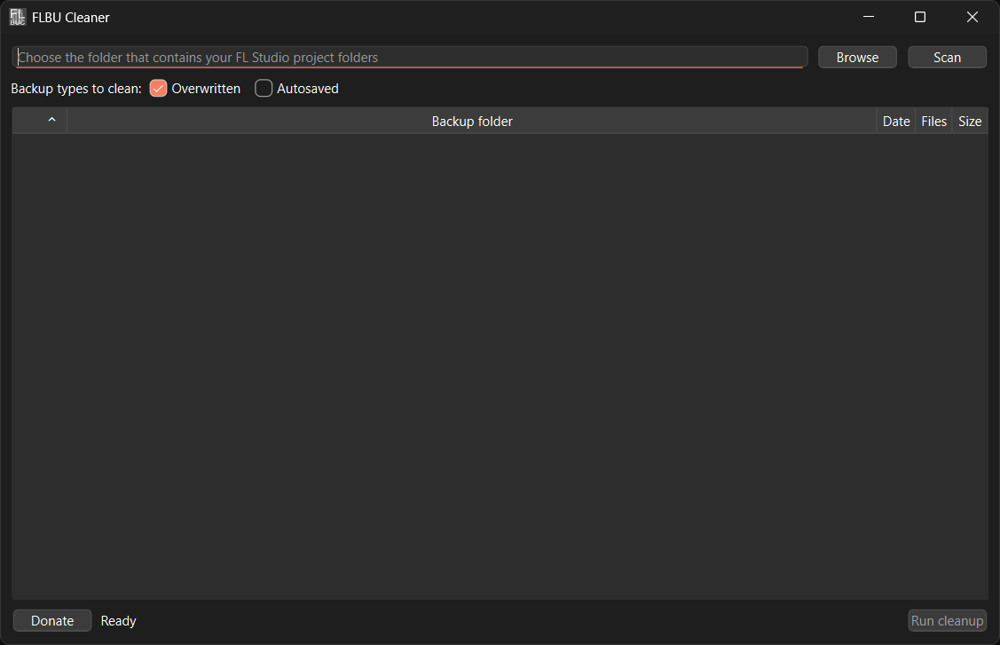

# FLBU Cleaner
A small Windows utility for cleaning FL Studio backup folders across multiple projects.

FLBU Cleaner scans a folder containing your FL Studio project folders, finds each project's `Backup` folder, and lets you safely clean selected backup files without going through every project manually.

## Features
- Scan a parent folder containing multiple FL Studio projects
- Detect non-empty `Backup` folders
- Clean:
  - Overwritten backups
  - Autosaved backups
  - Or both
- Select or deselect individual project backup folders
- View:
  - Backup folder path
  - Last modified date
  - Number of backup files
  - Total backup size
- Files are sent to the Windows Recycle Bin rather than permanently deleted
- Optional Ko-fi donation link
- No telemetry or data collection

## Download
Download the latest Windows installer from the GitHub Releases page.

## How to use
1. Open FLBU Cleaner
2. Choose the folder containing your FL Studio project folders
3. Select which backup types you want to clean
4. Click `Scan`
5. Deselect any project backups you want to keep
6. Click `Run cleanup`
7. Confirm the cleanup

## Backup types
### Overwritten
Previous versions of project files preserved by FL Studio before they were overwritten.

These can be useful if you want to recover an older version of a project.

### Autosaved
Automatic recovery saves created by FL Studio while you work.

These can be useful if FL Studio crashes or you need to recover unsaved work.

## Safety
FLBU Cleaner only targets `.flp` files matching the selected FL Studio backup types inside folders named `Backup`.

You can choose which projects you wish to clean or keep, by deselecting individual backup folders before running cleanup.

Additionally, files are sent to the Windows Recycle Bin rather than permanently deleted, so accidental cleanups can be undone by restoring the files from the Recycle Bin.


## Privacy
FLBU Cleaner does not collect, transmit, or analyze personal data or usage data.

The application does not connect to the internet during normal use.

The only external action is the optional `Donate` button, which asks for confirmation before opening the FLBU Cleaner Ko-fi page in your default web browser.

## Screenshots

<!--  -->

## Building from source

Requires Python 3.12 or later.

```bash
python -m venv .venv
pip install -r requirements.txt
pip install -e .
python -m flcleaner.app